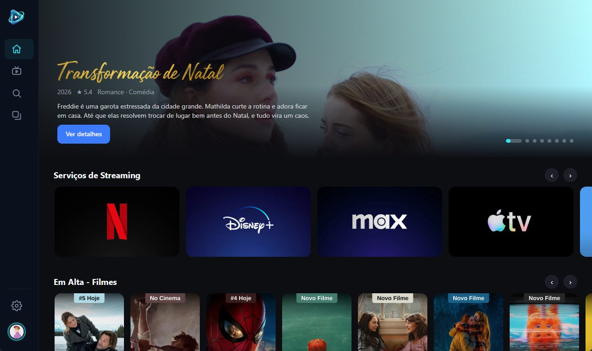

<p align="center">
  
</p>

<h1 align="center">Nuvio Astra</h1>

<p align="center">
  Unofficial fork of <a href="https://github.com/NuvioMedia/NuvioDesktop">Nuvio Desktop</a> for Windows, rewritten in <b>Rust + Tauri</b> to be lightweight and fast.<br/>
  Uses the same addons from the Stremio ecosystem and the same Nuvio account.
</p>

<p align="center">
  <a href="../../releases/latest"><b>⬇️ Download the latest version</b></a>
</p>

---

## Screenshots

| Home | Details |
|---|---|
|  |  |
| **Search** | **Live TV** |
|  |  |

<sub>The catalogs, covers, and information displayed come from addons installed by the user. No content is included with the application.</sub>

## Features

### Home and discovery

- **Featured carousel**, with the two catalogs of your choice.
- **Catalogs from your addons** in rows, which can be renamed, hidden, and reordered.
- **Nuvio account collections**, with GIF covers that animate on hover.
- **Search** with as-you-type results and search history.
- **Discover** on the search screen: filters by type, catalog, and genre from addons, with infinite scroll for more titles.
- **Details** with seasons, episodes, cast, and YouTube trailers.
- **Card format:** size, corners, landscape posters, and an option to hide titles.

### Sources and downloads

- **Debrid:** with your API key, cached torrents open instantly as direct links, without P2P. Supported services are **TorBox, Real-Debrid, AllDebrid, Premiumize, and Debrid-Link** (the first connected service is used by default; selection is in Settings → Services → Connected services). Also works with torrent addons configured without a key. Keys are synced with your Nuvio account per profile (`ProviderCredentialSync`).
- **Downloads** from HTTP, TorBox, or torrent sources, via the player button or by right-clicking the source, to the folder of your choice. Uses multiple simultaneous connections and supports resuming.
- **Source tags:** quality, HDR/Dolby Vision, codec, audio, size, and seeds.

### Source plugins

- **Nuvio scraper repositories** (`manifest.json`): add the URL in Settings → Addons → Plugins. Scripts are downloaded, validated, and executed in an isolated QuickJS engine with no access to files, the local network, or the session; the sources they find appear in each title's source list, just like addons. Works with community Nuvio scraper repositories. State is saved per profile and is not synced with the account.

  The sandbox includes the `crypto-js` API used by these scrapers (`WordArray`, `enc.Utf8/Hex/Base64`, MD5/SHA1/SHA256/SHA512, HmacSHA256, PBKDF2, and AES-CBC with PKCS#7, including OpenSSL `Salted__` envelopes). Primitives run natively in Rust rather than interpreted JavaScript.

  To test a repository without opening the application:

  ```bash
  cargo run -p nuvio-plugins --example live_check -- <manifest.json-url> <tmdb-id> <movie|tv> <limit>
  ```

### Player

- **Built-in player** (libmpv), with hardware acceleration, audio tracks, and playback speed control. In **Settings → Playback → Advanced audio and subtitles**, you can configure *Audio passthrough* for AC3/E-AC3/DTS/DTS-HD/TrueHD (with automatic fallback to PCM if the hardware rejects it) and *Subtitle code page* for legacy SRT files without BOM (for example, `cp1256` for Arabic). The `NUVIO_MPV_AUDIO_DEVICE` variable locks the output device, just like in the original Nuvio.
- **In-player subtitles:** embedded in the file, from the source, and from addons, with delay, size, and position adjustments.
- **Subtitle styling:** system or imported fonts, colors, outline, shadow, background, and alignment.
- **Skip intro, recap, and credits**, using video chapters, IntroDB, and AniSkip, with no API key required. Auto-skip is also supported.
- **Next episode**, with a source picker overlay on top of the video.
- **Picture-in-picture** with controls.
- **Torrent / P2P** directly in the player, with sequential playback before the download finishes.

### Image quality

- **Anime4K** with modes A, B, C, A+A, B+B, and C+A, plus sharpening, line art, and denoising shaders.
- **Color adjustments** and enhancement for movies and series.
- **Motion:** "Judder-free" (matches cadence to monitor refresh rate) or "Smooth" (blends adjacent frames).
- **NVIDIA RTX Video** Super Resolution and HDR, on compatible GPUs and drivers.

### Library, account, and profiles

- **Continue watching** with the next episode and an adjustable watched threshold from 90% to 100%.
- **Favorites and history** per profile.
- **Profiles** with PIN protection and avatars.
- **Automatic sync with your Nuvio account:** profiles, addons, favorites, progress, Home row order, and compatible preferences. Collections are fetched from the account.
- **Interface language:** Portuguese, English, or Arabic (right-to-left), saved to your Nuvio account. English and Arabic translations based on the contribution by aelrased.

### Live TV and updates

- **Live TV** with categories, favorites, addon filter, and program guide (EPG, when provided by the addon).
- **Automatic updates** directly inside the app, with signature verification.

Features from the original Nuvio that have not been ported yet are listed under **Settings → Not yet available**.

## Installation

1. Download `Nuvio-Astra-<version>-x64-setup.exe` from the [Releases](../../releases/latest) page.
2. Run the installer. Administrator privileges are not required.
3. New versions arrive directly through the app: a banner at the top displays the version and changelog.

**Requirements:** Windows 10 or 11 (64-bit) with Microsoft Edge WebView2 (already included in Windows 11).

The installer is not yet digitally signed, so Windows SmartScreen may ask for confirmation on first launch: **More info → Run anyway**. Release files include checksums in `SHA256SUMS.txt`.

On first launch, the app prompts for your Nuvio account and syncs automatically (you can also continue without an account). Existing Nuvio Desktop users can automatically import their profiles, addons, and library; your Nuvio Desktop password and login session are not copied, and original files remain untouched. Nuvio Astra data is stored in `%APPDATA%\NuvioNextGen` and is preserved across updates and uninstalls.

## Building from source

```powershell
cargo test --workspace
cd apps\nuvio-desktop\web; npm ci; npm run build; cd ..\..\..
cargo build --release -p nuvio-desktop
powershell -NoProfile -ExecutionPolicy Bypass -File packaging\windows\build-release.ps1 -SkipBuild -LibMpv <path\to\libmpv-2.dll>
```

Optional build settings (account server, update repository) can be found in [`local.properties.example`](local.properties.example). Publishing and automated releases: [`GITHUB_PUBLISH.md`](GITHUB_PUBLISH.md). Technical details: [`docs/`](docs/).

### Networking: blocked DNS and source headers

Addon and debrid service requests use an HTTP client with **DNS-over-HTTPS** fallback: if local DNS fails, times out, or returns a dead address, the domain is resolved over HTTPS (Cloudflare by default) and the connection is made to that IP using the original hostname in TLS. Optional environment variables:

- `NUVIO_DOH_URL` — DNS JSON endpoint (default: `https://cloudflare-dns.com/dns-query`).
- `NUVIO_DOH_FORCE=1` — query DoH first for any public hostname.
- `NUVIO_DOH_POISONED` — additional IP addresses treated as poisoned DNS responses (comma-separated).

Sources requiring custom HTTP headers (`proxyHeaders`, common in HLS streams) are served via a **local relay** on `127.0.0.1`: the player receives a local URL and the relay injects the headers into every request, including playlist segments. The relay runs only while the source is playing. Setting `NUVIO_RELAY=0` disables this behavior.

### Linux (experimental — phase 1 of the port)

The same codebase now builds and runs on Linux using WebKitGTK (Tauri 2):

```bash
# system dependencies (Debian/Ubuntu)
sudo apt install libwebkit2gtk-4.1-dev build-essential curl wget file libxdo-dev \
    libssl-dev libayatana-appindicator3-dev librsvg2-dev

cargo test --workspace
cd apps/nuvio-desktop/web && npm ci && npm run build && cd ../../..
cargo build --release -p nuvio-desktop
./target/release/nuvio-desktop
```

What already works: UI, catalogs, search, details, Live TV, library, profiles, settings, and Nuvio account. Data is stored in `$XDG_DATA_HOME/NuvioNextGen` (`~/.local/share/NuvioNextGen` by default), and legacy data migration runs on first launch.

**Player and P2P on Linux:** the player embeds the system's libmpv (`libmpv.so.2`) into an X11 child window (XWayland even on Wayland sessions), using `vo=gpu`, `gpu-context=x11egl` → `x11vk`, and VA-API hardware decoding—the same model as the original Nuvio Desktop Linux bridge. The P2P engine is the original `libnuvio_engine.so` (libtorrent), bundled in `apps/nuvio-desktop/native/linux/engine/`; its C ABI has been verified against all 23 symbols expected by `nuvio-p2p`.

The interface supports three languages (original Portuguese, English, and Arabic with RTL layout). You can select it under **Settings → Profile and data → Interface language**, and your choice is remembered across sessions; if unset, it follows the system locale.

The account session is protected using AES-256-GCM with a per-user key (`~/.local/share/NuvioAstra/.account.key`, mode `0600`) instead of Windows DPAPI. Automatic updates and AppImage/.deb packages are planned for phase 4. Tuning environment variables: `NUVIO_LIBMPV`, `NUVIO_MPV_GPU_CONTEXT`, `NUVIO_MPV_HWDEC`, `NUVIO_ENGINE_DLL`.

## Credits and copyright

**Nuvio Astra:** modifications and new code © 2026 [ScottGzin](https://github.com/ScottGzin) and contributors, under GPL-3.0.

**Original project:** Nuvio Astra is a modified version, started in November 2026, of [Nuvio Desktop](https://github.com/NuvioMedia/NuvioDesktop), © Nuvio team / [NuvioMedia](https://github.com/NuvioMedia) and its contributors, licensed under GPL-3.0. Copyright to the original code remains with its respective authors. The **Nuvio** name, brand, and logo belong to their respective owners.

### Included components

| Component | Author | License |
|---|---|---|
| [Nuvio Engine](https://github.com/NuvioMedia/nuvio-engine) (`nuvio_engine.dll`) | © NuvioMedia | GPL-3.0-or-later |
| [libtorrent](https://www.libtorrent.org), inside Nuvio Engine | © Arvid Norberg and contributors | BSD-3-Clause |
| [Boost](https://www.boost.org), inside Nuvio Engine | © Boost authors | BSL-1.0 |
| [OpenSSL](https://www.openssl.org), inside Nuvio Engine | © OpenSSL authors | Apache-2.0 |
| [try_signal](https://github.com/arvidn/try_signal), inside Nuvio Engine | © 2016 Arvid Norberg | BSD-3-Clause |
| [mpv / libmpv](https://mpv.io) (`libmpv-2.dll`) | © mpv authors | GPL-2.0-or-later |
| [FFmpeg](https://ffmpeg.org), inside libmpv | © FFmpeg developers | GPL, in this build |
| [Anime4K](https://github.com/bloc97/Anime4K) | © 2019–2021 bloc97 | MIT (`AutoDownscalePre`: Unlicense) |
| [Tauri](https://tauri.app) | © 2017–present Tauri Apps Contributors | MIT or Apache-2.0 |
| [React](https://react.dev) | © Meta Platforms, Inc. and affiliates | MIT |

All other libraries use permissive/free licenses such as MIT, Apache-2.0, BSD, ISC, Zlib, and Unicode-3.0. Third-party notices can be found in [`packaging/licenses`](packaging/licenses).

### Third-party services and data

These services are not part of Nuvio Astra, have no affiliation with the project, and are governed by their own terms:

- **[IntroDB](https://introdb.app):** community-submitted intro, recap, and credits timestamps ([terms](https://introdb.app/docs/terms)).
- **[AniSkip](https://api.aniskip.com/api-docs):** community-submitted anime opening and ending timestamps.
- **[ARM](https://github.com/BeeeQueue/arm-server)**, by BeeeQueue, with data from [Fribb/anime-lists](https://github.com/Fribb/anime-lists): mapping between anime identifiers.
- **YouTube:** trailer playback. YouTube is a trademark of Google LLC.
- **Addons:** catalogs, artwork, metadata, sources, and subtitles belong to their respective providers and authors.

NVIDIA and RTX are trademarks of NVIDIA Corporation. Windows and WebView2 are products of Microsoft Corporation.

## Legal disclaimer

- Nuvio Astra is **not affiliated with, sponsored by, or endorsed by** the Nuvio team.
- The application **does not host, distribute, or provide** movies, TV shows, channels, or any other content. It merely displays what the addons chosen by the user offer. Addons are third-party software and are not part of this project.
- Each user is responsible for the addons they install and the content they access, in accordance with the laws of their country. When using torrent/P2P, your IP address is visible to other peers on the network.
- Trademarks, covers, and images shown in the application or screenshots belong to their respective owners.

## Privacy

- Your Nuvio account password is sent only to the account server and is never stored locally. Your session is encrypted on this computer using Windows Data Protection API (DPAPI).
- When skip buttons are enabled, the app sends the title's public identifier (and season/episode numbers for series) to IntroDB, AniSkip, or ARM. As with any internet request, these services see your IP address. Skip buttons can be disabled in **Settings → Playback**.
- Installed addons receive requests for catalogs, sources, and subtitles. For subtitles, this may include the video file's name, size, and hash/identifier.

## License

[GNU General Public License v3.0](LICENSE), the same as Nuvio Desktop. You may use, study, modify, and redistribute Nuvio Astra under the terms of this license, provided you preserve copyright notices and make the source code available. This program is provided **without any warranty**. The complete source code for every release is available in this repository.
