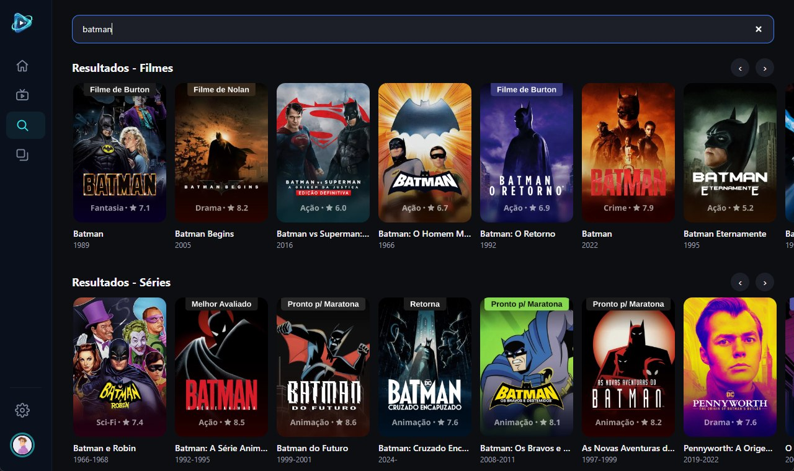

<p align="center">
  
</p>

<h1 align="center">Nuvio Astra</h1>

<p align="center">
  Fork não oficial do <a href="https://github.com/NuvioMedia/NuvioDesktop">Nuvio Desktop</a> para Windows, reescrito em <b>Rust + Tauri</b> para ser leve e rápido.<br/>
  Usa os mesmos addons do ecossistema Stremio e a mesma conta Nuvio.
</p>

<p align="center">
  <a href="../../releases/latest"><b>⬇️ Baixar a versão mais recente</b></a>
</p>

---

## Capturas de tela

| Início | Detalhes |
|---|---|
|  |  |
| **Pesquisa** | **TV ao vivo** |
|  |  |

<sub>Os catálogos, capas e informações exibidos vêm dos addons instalados pelo usuário. Nenhum conteúdo acompanha o aplicativo.</sub>

## Recursos

- **Início, pesquisa e detalhes:** catálogos dos seus addons em fileiras, pesquisa com resultados enquanto você digita e histórico, temporadas, episódios e elenco.
- **Player embutido** (libmpv): aceleração por hardware, faixas de áudio e legendas, estilos de legenda, PiP.
- **Torrent / P2P** no próprio player, com reprodução antes do download terminar.
- **Trailers do YouTube** na tela de detalhes.
- **TV ao vivo** com categorias, filtro por addon e guia de programação (quando o addon informa).
- **Biblioteca:** favoritos, histórico e "Continuar assistindo".
- **Perfis** com PIN e avatares, e **sincronização com a conta Nuvio**.
- **Atualizações automáticas** pelo próprio app, com verificação de assinatura.

## Instalação

1. Baixe `Nuvio-Astra-<versão>-x64-setup.exe` na página de [Releases](../../releases/latest).
2. Execute o instalador. Não é preciso ser administrador.
3. Novas versões chegam pelo próprio aplicativo: um aviso no topo mostra a versão e as novidades.

**Requisitos:** Windows 10 ou 11 (64 bits) com o Microsoft Edge WebView2 (já incluído no Windows 11).

O instalador ainda não tem assinatura digital, então o Windows SmartScreen pode pedir confirmação na primeira vez: **Mais informações → Executar assim mesmo**. Os arquivos de cada versão têm checksums em `SHA256SUMS.txt`.

Quem já usa o Nuvio Desktop pode ter perfis, addons e biblioteca importados automaticamente na primeira abertura. Os arquivos originais não são alterados. Os dados do Nuvio Astra ficam em `%APPDATA%\NuvioNextGen` e são mantidos em atualizações e desinstalações.

## Compilar a partir do código

```powershell
cargo test --workspace
cd apps\nuvio-desktop\web; npm ci; npm run build; cd ..\..\..
cargo build --release -p nuvio-desktop
powershell -NoProfile -ExecutionPolicy Bypass -File packaging\windows\build-release.ps1 -SkipBuild -LibMpv <caminho\libmpv-2.dll>
```

Configurações opcionais de build (servidor da conta, repositório de atualizações) estão em [`local.properties.example`](local.properties.example). Publicação e releases automáticas: [`GITHUB_PUBLISH.md`](GITHUB_PUBLISH.md). Detalhes técnicos: [`docs/`](docs/).

### Linux (experimental — fase 1 do port)

O mesmo código agora compila e roda no Linux com WebKitGTK (Tauri 2):

```bash
# dependências do sistema (Debian/Ubuntu)
sudo apt install libwebkit2gtk-4.1-dev build-essential curl wget file libxdo-dev \
    libssl-dev libayatana-appindicator3-dev librsvg2-dev

cargo test --workspace
cd apps/nuvio-desktop/web && npm ci && npm run build && cd ../../..
cargo build --release -p nuvio-desktop
./target/release/nuvio-desktop
```

O que já funciona: interface, catálogos, busca, detalhes, TV ao vivo, biblioteca, perfis,
configurações e conta Nuvio. Os dados ficam em `$XDG_DATA_HOME/NuvioNextGen`
(`~/.local/share/NuvioNextGen` por padrão) e a migração dos dados legados é feita na primeira abertura.

**Player e P2P no Linux:** o player incorpora o libmpv do sistema (`libmpv.so.2`) numa janela filha
X11 (XWayland mesmo em sessões Wayland), com `vo=gpu`, `gpu-context=x11egl` → `x11vk` e decodificação
por VA-API — o mesmo modelo do bridge Linux do Nuvio Desktop original. O motor P2P é o
`libnuvio_engine.so` original (libtorrent), incluído em `apps/nuvio-desktop/native/linux/engine/`;
a ABI C foi verificada contra os 23 símbolos esperados por `nuvio-p2p`.

A interface tem três idiomas (português original, inglês e árabe, com layout RTL). A escolha fica
em **Configurações → Perfil e dados → Idioma da interface** e é lembrada entre execuções; sem
escolha explícita, segue o idioma do sistema.

A sessão da conta é protegida por AES-256-GCM com uma chave por usuário
(`~/.local/share/NuvioAstra/.account.key`, permissão 0600) no lugar da DPAPI. Atualizações
automáticas e pacotes AppImage/.deb vêm na fase 4. Variáveis de ajuste: `NUVIO_LIBMPV`,
`NUVIO_MPV_GPU_CONTEXT`, `NUVIO_MPV_HWDEC`, `NUVIO_ENGINE_DLL`.

## Créditos e direitos autorais

- **Nuvio Desktop**, © equipe Nuvio / [NuvioMedia](https://github.com/NuvioMedia), licenciado sob a GPL-3.0. O Nuvio Astra é um projeto derivado dele (fork). O nome, a marca e o logotipo **Nuvio** pertencem aos seus respectivos donos.
- **[Nuvio Engine](https://github.com/NuvioMedia/nuvio-engine)** (`nuvio_engine.dll`), © NuvioMedia, GPL-3.0. Inclui libtorrent (BSD-3-Clause), Boost (BSL-1.0) e OpenSSL (Apache-2.0).
- **[mpv / libmpv](https://mpv.io)** e FFmpeg, sob a GPL.
- **[Tauri](https://tauri.app)**, **React** e as bibliotecas Rust e JavaScript usadas, sob as licenças MIT e/ou Apache-2.0.

Os textos completos das licenças de terceiros acompanham o instalador (pasta `licenses`) e estão em [`packaging/licenses`](packaging/licenses).

## Aviso legal

- O Nuvio Astra **não é afiliado, patrocinado nem endossado** pela equipe do Nuvio.
- O aplicativo **não hospeda, distribui nem fornece** filmes, séries, canais ou qualquer outro conteúdo. Ele apenas exibe o que os addons escolhidos pelo usuário oferecem. Os addons são de terceiros e não fazem parte deste projeto.
- Cada usuário é responsável pelos addons que instala e pelo conteúdo que acessa, de acordo com as leis do seu país. Ao usar torrent/P2P, o seu endereço IP fica visível para outros participantes da rede.
- Marcas, capas e imagens que aparecem no aplicativo ou nas capturas pertencem aos seus respectivos donos.

## Licença

[GNU General Public License v3.0](LICENSE), a mesma do Nuvio Desktop. O código-fonte completo de cada versão está neste repositório.
