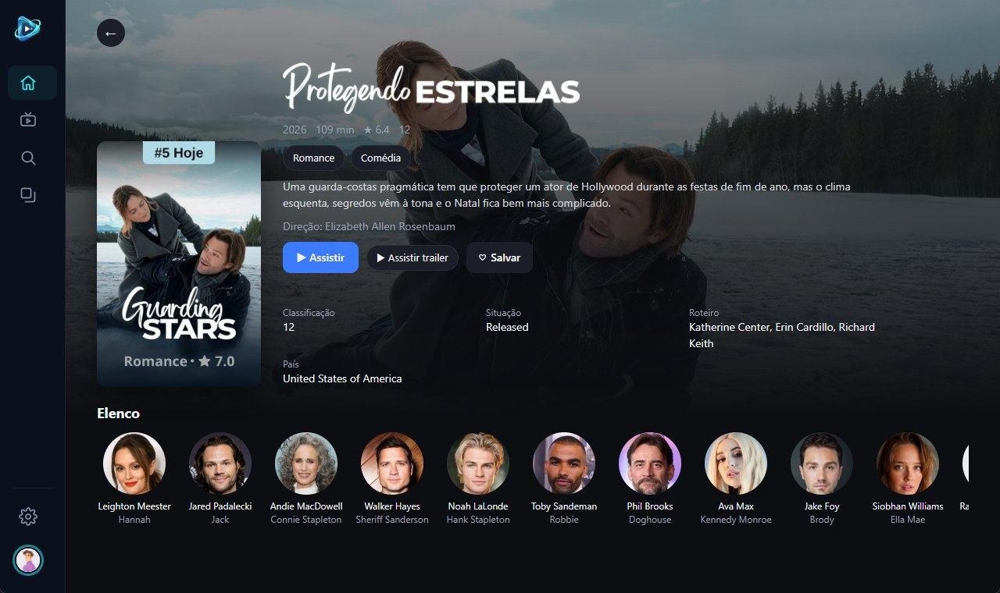

<p align="center">
  
</p>

<h1 align="center">Nuvio Astra</h1>

<p align="center">
  An unofficial fork of <a href="https://github.com/NuvioMedia/NuvioDesktop">Nuvio Desktop</a> for Windows, rewritten in <b>Rust + Tauri</b> to be light and fast.<br/>
  It uses the same addons as the Stremio ecosystem and the same Nuvio account.
</p>

<p align="center">
  <a href="../../releases/latest"><b>⬇️ Download the latest version</b></a>
  &nbsp;·&nbsp;
  <a href="README.pt-BR.md">🇧🇷 Leia em português</a>
</p>

---

## Screenshots

| Home | Details |
|---|---|
|  |  |
| **Search** | **Live TV** |
|  |  |

<sub>The catalogs, posters and information shown come from the addons the user installs. No content ships with the app.</sub>

## Features

### Home, search and discovery

- **Hero carousel** with the two catalogs you choose.
- **Your addons' catalogs** as rows that can be renamed, hidden and reordered, with a "+" card to see the whole catalog.
- **Nuvio account collections**, with animated GIF covers on hover, and a collection editor.
- **Search** with results as you type and history; **Discover** right below it (like the original): browse any catalog of any installed addon by type, catalog and genre.
- **Details** with seasons, episodes, cast, trailers (in the language you choose), "mark as watched" and spoiler blur.
- **Card style:** size, corners, landscape posters, hover preview and custom poster addresses (e.g. RPDB).

### Sources and downloads

- **Debrid:** TorBox, Real-Debrid, AllDebrid, Premiumize and Debrid-Link. Cached torrents show as **Instant** and open right away, without P2P.
- **Automatic source choice** (first source or a regex), trying the next source when one fails, and replaying the last link.
- **Source filters** by addon, quality (4K, 1080p, 720p, 480p, P2P) and badges (HDR/Dolby Vision, codec, audio, size, seeds).
- **Scraper plugins:** add a Nuvio plugin repository (`manifest.json`). Plugins run in an isolated QuickJS sandbox with no access to your computer or local network.
- **Downloads** from HTTP, debrid or torrent sources, with several connections at once and resume.

### Player

- **Built-in player** (libmpv) with hardware acceleration, audio tracks, speed, hold-to-speed-up, chapters and keyboard shortcuts.
- **Subtitles:** from the file, the source and the addons, with delay, size, position, style and **automatic sync** against the embedded track.
- **Skip intro, recap and credits** with the video's chapters, IntroDB and AniSkip, no key needed; optional auto-skip.
- **Next episode** and switching the source without leaving the player; episode list; content warnings.
- **Audio:** volume boost and stereo downmix. **Picture-in-picture** with controls.
- **Torrent / P2P** in the player itself, playing before the download ends.

### Picture quality

- **Anime4K** in modes A, B, C, A+A, B+B and C+A, plus sharpening, line and denoise effects.
- **Color adjustments** and enhancement for movies and series.
- **Motion:** "No judder" (matches the monitor's rhythm) or "Smooth" (blends neighboring frames).
- **NVIDIA RTX Video** Super Resolution and HDR on compatible cards and drivers.

### Library, account and profiles

- **Continue watching** with the next episode, several styles, a resume prompt and an adjustable watched threshold (90% to 100%).
- **Favorites and history** per profile; **profiles** with PIN and avatars, and a "who's watching?" screen.
- **Automatic sync with the Nuvio account:** profiles, addons, favorites, progress, Home order, collections and compatible preferences.
- **29 interface languages**, the same as Nuvio Desktop (right-to-left for Arabic, Hebrew and Urdu). The app opens in your system's language, then follows the language saved in your Nuvio account.

### Integrations

- **TMDB** (your own free key): artwork, localized titles and synopses, cast with photos, episodes, season posters, "More like this", movie sagas, and pages for actors, studios and networks.
- **Simkl:** one-click sign-in, scrobbling, watched marks and history import.
- **MDBList** (your own free key): IMDb, Rotten Tomatoes, Metacritic, Letterboxd, Trakt, TMDB and MyAnimeList ratings on the details page.
- **Discord Rich Presence:** shows on your Discord profile what you are watching.

### Live TV and updates

- **Live TV** with categories, favorites, addon filter and program guide (when the addon provides it).
- **M3U playlists** by address or local file, with their categories, logos and headers.
- **Today's games:** live scores (ESPN) with "where to watch" found in your channels' guides, only when you ask.
- **Automatic updates** through the app itself, with signature verification.

What has not been ported from the original Nuvio yet is listed in **Settings → Not available yet**.

## Installation

1. Download `Nuvio-Astra-<version>-x64-setup.exe` from the [Releases](../../releases/latest) page.
2. Run the installer. It opens in your Windows language and does not need administrator rights.
3. New versions arrive through the app itself: a banner at the top shows the version and what's new.

**Requirements:** Windows 10 or 11 (64-bit) with Microsoft Edge WebView2 (already part of Windows 11).

The installer is not digitally signed yet, so Windows SmartScreen may ask for confirmation the first time: **More info → Run anyway**. Each release has checksums in `SHA256SUMS.txt`.

On first launch the app asks for your Nuvio account and syncs by itself (you can also continue without an account). If you already use Nuvio Desktop, your profiles, addons and library can be imported automatically; Nuvio Desktop's password and sign-in are not copied, and its files are not changed. Nuvio Astra's data lives in `%APPDATA%\NuvioNextGen` and is kept across updates and uninstalls.

## Building from source

```powershell
cargo test --workspace
cd apps\nuvio-desktop\web; npm ci; npm run build; cd ..\..\..
cargo build --release -p nuvio-desktop
powershell -NoProfile -ExecutionPolicy Bypass -File packaging\windows\build-release.ps1 -SkipBuild -LibMpv <path\libmpv-2.dll>
```

Optional build settings (account server, update repository, Simkl and Discord application ids) are in [`local.properties.example`](local.properties.example). Technical details: [`docs/`](docs/).

## Credits and copyright

**Nuvio Astra:** changes and new code © 2026 [ScottGzin](https://github.com/ScottGzin) and contributors, under the GPL-3.0. Many features (29 languages, debrid services, scraper plugins, player and screen improvements) build on the contributions of [aelrased](https://github.com/aelrased).

**Original project:** Nuvio Astra is a modified version, started in November 2026, of [Nuvio Desktop](https://github.com/NuvioMedia/NuvioDesktop), © the Nuvio team / [NuvioMedia](https://github.com/NuvioMedia) and its contributors, licensed under the GPL-3.0. The rights to the original code remain with its authors. The **Nuvio** name, brand and logo belong to their respective owners.

### Bundled components

| Component | Authors | License |
|---|---|---|
| [Nuvio Engine](https://github.com/NuvioMedia/nuvio-engine) (`nuvio_engine.dll`) | © NuvioMedia | GPL-3.0-or-later |
| [libtorrent](https://www.libtorrent.org), inside Nuvio Engine | © Arvid Norberg and contributors | BSD-3-Clause |
| [Boost](https://www.boost.org), inside Nuvio Engine | © the Boost authors | BSL-1.0 |
| [OpenSSL](https://www.openssl.org), inside Nuvio Engine | © the OpenSSL authors | Apache-2.0 |
| [try_signal](https://github.com/arvidn/try_signal), inside Nuvio Engine | © 2016 Arvid Norberg | BSD-3-Clause |
| [mpv / libmpv](https://mpv.io) (`libmpv-2.dll`) | © the mpv authors | GPL-2.0-or-later |
| [FFmpeg](https://ffmpeg.org), inside libmpv | © the FFmpeg developers | GPL, in this build |
| [Anime4K](https://github.com/bloc97/Anime4K) | © 2019–2021 bloc97 | MIT (`AutoDownscalePre`: Unlicense) |
| [QuickJS](https://bellard.org/quickjs/) via [rquickjs](https://github.com/DelSkayn/rquickjs) | © Fabrice Bellard, Charlie Gordon and the rquickjs authors | MIT |
| [Tauri](https://tauri.app) | © 2017–present Tauri Apps Contributors | MIT or Apache-2.0 |
| [React](https://react.dev) | © Meta Platforms, Inc. and affiliates | MIT |

The other libraries use free licenses such as MIT, Apache-2.0, BSD, ISC, Zlib and Unicode-3.0. Third-party notices are in [`packaging/licenses`](packaging/licenses).

### Third-party services and data

These services are not part of Nuvio Astra, have no link to the project and follow their own terms:

- **[IntroDB](https://introdb.app):** community-submitted intro, recap and credits times ([terms](https://introdb.app/docs/terms)).
- **[AniSkip](https://api.aniskip.com/api-docs):** community-submitted anime opening and ending times.
- **[ARM](https://github.com/BeeeQueue/arm-server)** by BeeeQueue, with data from [Fribb/anime-lists](https://github.com/Fribb/anime-lists): matching between anime ids.
- **[TMDB](https://www.themoviedb.org):** this product uses the TMDB API but is not endorsed or certified by TMDB.
- **[Simkl](https://simkl.com)** and **[MDBList](https://mdblist.com):** watch tracking and ratings, with your own account or key.
- **ESPN:** scores of "Today's games". **Discord:** Rich Presence through the Discord app on your computer.
- **YouTube:** trailer playback. YouTube is a trademark of Google LLC.
- **Addons and plugins:** catalogs, posters, information, sources and subtitles belong to their providers and authors.

NVIDIA and RTX are trademarks of NVIDIA Corporation. Windows and WebView2 are products of Microsoft Corporation.

## Disclaimer

- Nuvio Astra is **not affiliated with, sponsored by or endorsed by** the Nuvio team.
- The app **does not host, distribute or provide** movies, series, channels or any other content. It only shows what the addons and plugins chosen by the user offer. Addons and plugins are third-party and not part of this project.
- Each user is responsible for the addons and plugins they install and the content they access, according to the laws of their country. When using torrent/P2P, your IP address is visible to other peers on the network.
- Brands, posters and images shown in the app or in the screenshots belong to their respective owners.

## Privacy

- The Nuvio account password is sent only to the account server and is not stored. The session is encrypted on this computer by Windows (DPAPI), and so are the TMDB, MDBList and debrid keys, the Simkl sign-in and the M3U playlist addresses.
- With the skip buttons on, the app sends IntroDB, AniSkip or ARM the title's public id and, for series, the season or episode. Like any internet access, these services see your IP. The buttons can be turned off in **Settings → Player**.
- TMDB, Simkl, MDBList and ESPN are contacted only when you turn them on (TMDB, Simkl and MDBList) or open "Today's games" (ESPN). Discord Rich Presence talks only to the Discord app on your computer and is off by default.
- Installed addons and plugins receive the requests for catalogs, sources and subtitles. For subtitles, this may include the video file's name, size and id.

## License

[GNU General Public License v3.0](LICENSE), the same as Nuvio Desktop. You may use, study, modify and redistribute Nuvio Astra under the terms of that license, keeping the copyright notices and making the source code available. The program comes **without any warranty**. The full source code of every version is in this repository.
