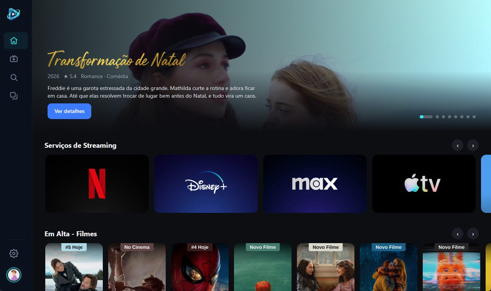
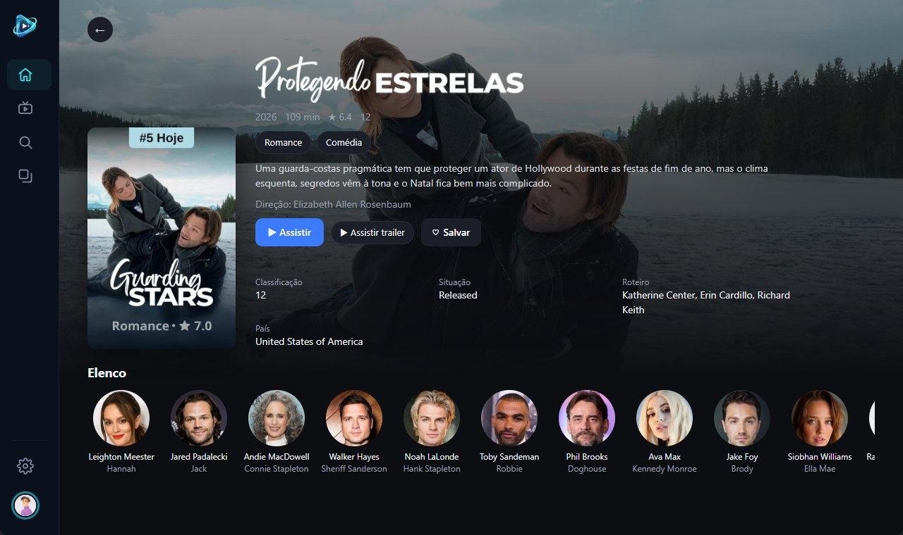
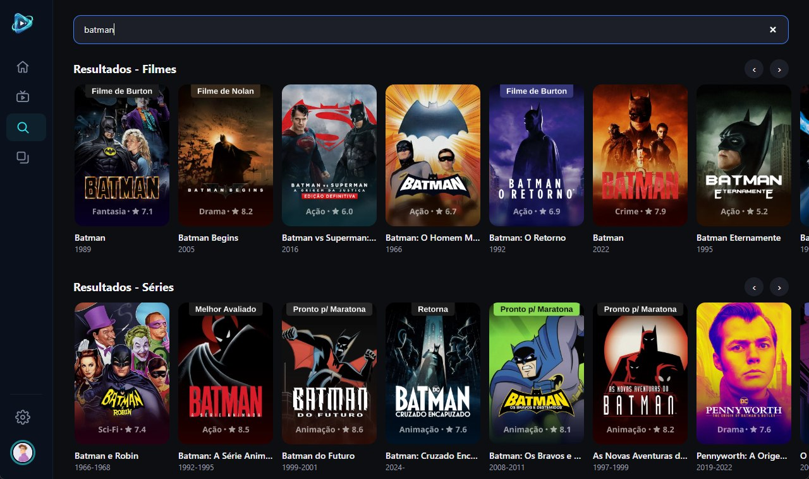
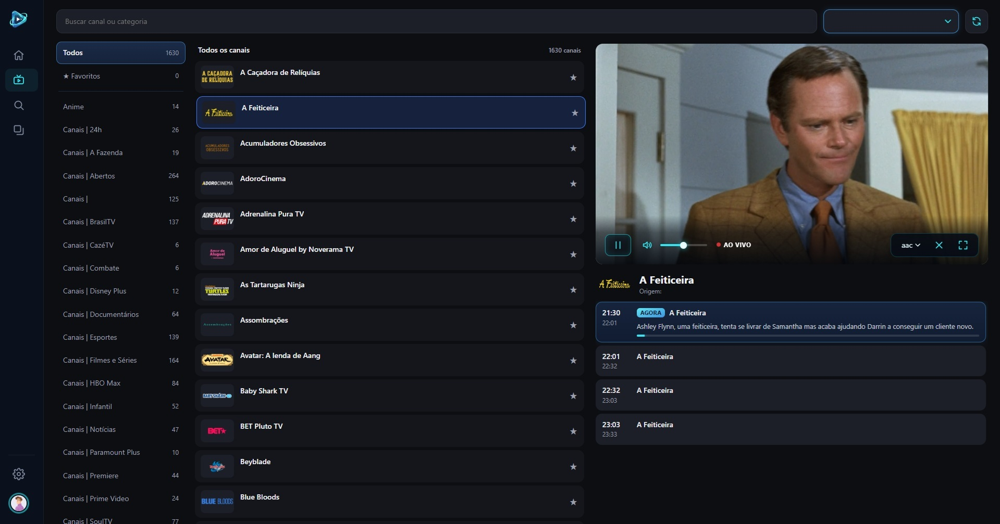

<p align="center">
  
</p>

<h1 align="center">Nuvio Astra</h1>

<p align="center">
  Fork não oficial do <a href="https://github.com/NuvioMedia/NuvioDesktop">Nuvio Desktop</a> para Windows, reescrito em <b>Rust + Tauri</b> para ser leve e rápido.<br/>
  Usa os mesmos addons do ecossistema Stremio e a mesma conta Nuvio.
</p>

<p align="center">
  <a href="../../releases/latest"><b>⬇️ Baixar a versão mais recente</b></a>
  &nbsp;·&nbsp;
  <a href="README.md">🇺🇸 Read in English</a>
</p>

---

## Capturas de tela

| Início | Detalhes |
|---|---|
|  |  |
| **Pesquisa** | **TV ao vivo** |
|  |  |

<sub>Os catálogos, capas e informações exibidos vêm dos addons instalados pelo usuário. Nenhum conteúdo acompanha o aplicativo.</sub>

## Recursos

### Início, pesquisa e descoberta

- **Destaque em carrossel**, com os dois catálogos que você escolher.
- **Catálogos dos seus addons** em fileiras, que podem ser renomeadas, ocultadas e reordenadas, com um card "+" para ver o catálogo inteiro.
- **Coleções da conta Nuvio**, com capas em GIF que animam ao passar o mouse, e editor de coleções.
- **Pesquisa** com resultados enquanto você digita e histórico; logo abaixo, o **Descobrir** (como no original): navegue por qualquer catálogo de qualquer addon instalado, por tipo, catálogo e gênero.
- **Detalhes** com temporadas, episódios, elenco, trailers (no idioma escolhido), "marcar como assistido" e desfoque contra spoilers.
- **Formato dos cards:** tamanho, cantos, pôsteres em paisagem, prévia ao passar o mouse e endereços de pôster próprios (ex.: RPDB).

### Fontes e downloads

- **Debrid:** TorBox, Real-Debrid, AllDebrid, Premiumize e Debrid-Link. Torrents que já estão no cache aparecem como **Instant** e abrem na hora, sem P2P.
- **Escolha automática da fonte** (primeira fonte ou por regex), tentando a próxima quando uma falha, e repetição do último link.
- **Filtros de fontes** por addon, qualidade (4K, 1080p, 720p, 480p, P2P) e etiquetas (HDR/Dolby Vision, codec, áudio, tamanho, seeds).
- **Plugins de busca:** adicione um repositório de plugins do Nuvio (`manifest.json`). Os plugins rodam isolados no QuickJS, sem acesso ao seu computador nem à rede local.
- **Downloads** de fontes HTTP, debrid ou torrent, com várias conexões ao mesmo tempo e continuando de onde parou.

### Player

- **Player embutido** (libmpv), com aceleração por hardware, faixas de áudio, velocidade, segurar para acelerar, capítulos e atalhos de teclado.
- **Legendas:** do arquivo, da fonte e dos addons, com atraso, tamanho, posição, estilo e **sincronização automática** pela faixa embutida.
- **Pular introdução, recapitulação e créditos** com os capítulos do vídeo, IntroDB e AniSkip, sem precisar de chave; também pode pular sozinho.
- **Próximo episódio** e troca de fonte sem sair do player; lista de episódios; avisos de conteúdo.
- **Áudio:** aumento de volume e downmix estéreo. **Picture-in-picture** com controles.
- **Torrent / P2P** no próprio player, com reprodução antes do download terminar.

### Qualidade de imagem

- **Anime4K** com modos A, B, C, A+A, B+B e C+A, além de efeitos de nitidez, traço e redução de ruído.
- **Ajustes de cor** e melhoria para filmes e séries.
- **Movimento:** "Sem tremidas" (ajusta o ritmo ao monitor) ou "Fluido" (mistura quadros vizinhos).
- **NVIDIA RTX Video** Super Resolution e HDR, em placas e drivers compatíveis.

### Biblioteca, conta e perfis

- **Continuar assistindo** com o próximo episódio, vários estilos, pergunta de retomada e porcentagem de assistido ajustável de 90% a 100%.
- **Favoritos e histórico** por perfil; **perfis** com PIN e avatares, e a tela "Quem está assistindo?".
- **Sincronização automática com a conta Nuvio:** perfis, addons, favoritos, progresso, ordem do Início, coleções e preferências compatíveis.
- **29 idiomas na interface**, os mesmos do Nuvio Desktop (da direita para a esquerda em árabe, hebraico e urdu). O app abre no idioma do sistema e depois segue o idioma salvo na conta Nuvio.

### Integrações

- **TMDB** (com a sua chave gratuita): artes, títulos e sinopses traduzidos, elenco com fotos, episódios, pôsteres das temporadas, "Mais como este", sagas de filmes e páginas de atores, estúdios e canais.
- **Simkl:** conexão com um clique, scrobble, marcações de assistido e importação do histórico.
- **MDBList** (com a sua chave gratuita): notas do IMDb, Rotten Tomatoes, Metacritic, Letterboxd, Trakt, TMDB e MyAnimeList na tela de detalhes.
- **Discord Rich Presence:** mostra no seu perfil do Discord o que você está assistindo.

### TV ao vivo e atualizações

- **TV ao vivo** com categorias, favoritos, filtro por addon e guia de programação (quando o addon informa).
- **Listas M3U** por endereço ou arquivo local, com categorias, logos e cabeçalhos.
- **Jogos de hoje:** placares ao vivo (ESPN) com "onde passa" encontrado nos guias dos seus canais, só quando você pede.
- **Atualizações automáticas** pelo próprio app, com verificação de assinatura.

O que ainda não foi portado do Nuvio original está em **Configurações → Ainda não disponível**.

## Instalação

1. Baixe `Nuvio-Astra-<versão>-x64-setup.exe` na página de [Releases](../../releases/latest).
2. Execute o instalador. Ele abre no idioma do Windows e não é preciso ser administrador.
3. Novas versões chegam pelo próprio aplicativo: um aviso no topo mostra a versão e as novidades.

**Requisitos:** Windows 10 ou 11 (64 bits) com o Microsoft Edge WebView2 (já incluído no Windows 11).

O instalador ainda não tem assinatura digital, então o Windows SmartScreen pode pedir confirmação na primeira vez: **Mais informações → Executar assim mesmo**. Os arquivos de cada versão têm checksums em `SHA256SUMS.txt`.

Na primeira abertura, o app pede a conta Nuvio e sincroniza sozinho (também dá para continuar sem conta). Quem já usa o Nuvio Desktop pode ter perfis, addons e biblioteca importados automaticamente; a senha e o login do Nuvio Desktop não são copiados, e os arquivos originais não são alterados. Os dados do Nuvio Astra ficam em `%APPDATA%\NuvioNextGen` e são mantidos em atualizações e desinstalações.

## Compilar a partir do código

```powershell
cargo test --workspace
cd apps\nuvio-desktop\web; npm ci; npm run build; cd ..\..\..
cargo build --release -p nuvio-desktop
powershell -NoProfile -ExecutionPolicy Bypass -File packaging\windows\build-release.ps1 -SkipBuild -LibMpv <caminho\libmpv-2.dll>
```

Configurações opcionais de build (servidor da conta, repositório de atualizações, ids dos apps do Simkl e do Discord) estão em [`local.properties.example`](local.properties.example). Detalhes técnicos: [`docs/`](docs/).

## Créditos e direitos autorais

**Nuvio Astra:** modificações e código novo © 2026 [ScottGzin](https://github.com/ScottGzin) e contribuidores, sob a GPL-3.0. Muitos recursos (29 idiomas, serviços debrid, plugins de busca, melhorias no player e nas telas) partem das contribuições de [aelrased](https://github.com/aelrased).

**Projeto original:** o Nuvio Astra é uma versão modificada, iniciada em novembro de 2026, do [Nuvio Desktop](https://github.com/NuvioMedia/NuvioDesktop), © equipe Nuvio / [NuvioMedia](https://github.com/NuvioMedia) e seus contribuidores, licenciado sob a GPL-3.0. Os direitos sobre o código original continuam com seus autores. O nome, a marca e o logotipo **Nuvio** pertencem aos seus respectivos donos.

### Componentes incluídos

| Componente | Autoria | Licença |
|---|---|---|
| [Nuvio Engine](https://github.com/NuvioMedia/nuvio-engine) (`nuvio_engine.dll`) | © NuvioMedia | GPL-3.0-or-later |
| [libtorrent](https://www.libtorrent.org), dentro do Nuvio Engine | © Arvid Norberg e contribuidores | BSD-3-Clause |
| [Boost](https://www.boost.org), dentro do Nuvio Engine | © autores do Boost | BSL-1.0 |
| [OpenSSL](https://www.openssl.org), dentro do Nuvio Engine | © autores do OpenSSL | Apache-2.0 |
| [try_signal](https://github.com/arvidn/try_signal), dentro do Nuvio Engine | © 2016 Arvid Norberg | BSD-3-Clause |
| [mpv / libmpv](https://mpv.io) (`libmpv-2.dll`) | © autores do mpv | GPL-2.0-or-later |
| [FFmpeg](https://ffmpeg.org), dentro do libmpv | © desenvolvedores do FFmpeg | GPL, nesta compilação |
| [Anime4K](https://github.com/bloc97/Anime4K) | © 2019–2021 bloc97 | MIT (`AutoDownscalePre`: Unlicense) |
| [QuickJS](https://bellard.org/quickjs/) via [rquickjs](https://github.com/DelSkayn/rquickjs) | © Fabrice Bellard, Charlie Gordon e autores do rquickjs | MIT |
| [Tauri](https://tauri.app) | © 2017–presente Tauri Apps Contributors | MIT ou Apache-2.0 |
| [React](https://react.dev) | © Meta Platforms, Inc. e afiliadas | MIT |

As demais bibliotecas usam licenças livres, como MIT, Apache-2.0, BSD, ISC, Zlib e Unicode-3.0. Os avisos de terceiros estão em [`packaging/licenses`](packaging/licenses).

### Serviços e dados de terceiros

Estes serviços não fazem parte do Nuvio Astra, não têm vínculo com o projeto e seguem os próprios termos:

- **[IntroDB](https://introdb.app):** tempos de introdução, recapitulação e créditos enviados pela comunidade ([termos](https://introdb.app/docs/terms)).
- **[AniSkip](https://api.aniskip.com/api-docs):** tempos de abertura e encerramento de animes enviados pela comunidade.
- **[ARM](https://github.com/BeeeQueue/arm-server)**, de BeeeQueue, com dados de [Fribb/anime-lists](https://github.com/Fribb/anime-lists): correspondência entre identificadores de animes.
- **[TMDB](https://www.themoviedb.org):** este produto usa a API do TMDB, mas não é endossado nem certificado pelo TMDB.
- **[Simkl](https://simkl.com)** e **[MDBList](https://mdblist.com):** acompanhamento do que você assiste e notas, com a sua conta ou chave.
- **ESPN:** placares dos "Jogos de hoje". **Discord:** Rich Presence pelo app do Discord no seu computador.
- **YouTube:** reprodução de trailers. YouTube é uma marca da Google LLC.
- **Addons e plugins:** catálogos, capas, informações, fontes e legendas pertencem aos seus provedores e autores.

NVIDIA e RTX são marcas da NVIDIA Corporation. Windows e WebView2 são produtos da Microsoft Corporation.

## Aviso legal

- O Nuvio Astra **não é afiliado, patrocinado nem endossado** pela equipe do Nuvio.
- O aplicativo **não hospeda, distribui nem fornece** filmes, séries, canais ou qualquer outro conteúdo. Ele apenas exibe o que os addons e plugins escolhidos pelo usuário oferecem. Addons e plugins são de terceiros e não fazem parte deste projeto.
- Cada usuário é responsável pelos addons e plugins que instala e pelo conteúdo que acessa, de acordo com as leis do seu país. Ao usar torrent/P2P, o seu endereço IP fica visível para outros participantes da rede.
- Marcas, capas e imagens que aparecem no aplicativo ou nas capturas pertencem aos seus respectivos donos.

## Privacidade

- A senha da conta Nuvio é enviada apenas ao servidor da conta e não é armazenada. A sessão fica criptografada neste computador pelo Windows (DPAPI), assim como as chaves do TMDB, MDBList e debrid, o login do Simkl e os endereços das listas M3U.
- Com os botões de pular ativados, o app envia ao IntroDB, AniSkip ou ARM o identificador público do título e, para séries, a temporada ou o episódio. Como em qualquer acesso à internet, esses serviços veem o seu IP. Os botões podem ser desligados em **Configurações → Reprodução**.
- TMDB, Simkl, MDBList e ESPN só são acessados quando você os ativa (TMDB, Simkl e MDBList) ou abre os "Jogos de hoje" (ESPN). O Discord Rich Presence conversa só com o app do Discord no seu computador e vem desligado.
- Os addons e plugins instalados recebem os pedidos de catálogo, fontes e legendas. Para legendas, isso pode incluir o nome, o tamanho e o identificador do arquivo de vídeo.

## Licença

[GNU General Public License v3.0](LICENSE), a mesma do Nuvio Desktop. Você pode usar, estudar, modificar e redistribuir o Nuvio Astra seguindo os termos dessa licença, mantendo os avisos de direitos autorais e disponibilizando o código-fonte. O programa é fornecido **sem qualquer garantia**. O código-fonte completo de cada versão está neste repositório.
